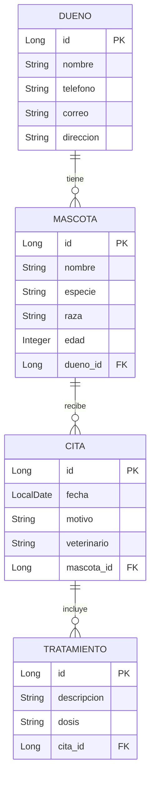

# Laboratorio #2: Sistema de Gestión Veterinaria
**Universidad del Valle - Sede Tuluá**  
**Programa:** Tecnología en Sistemas  
**Materia:** Desarrollo de Software III  
**Docente:** Mg(c). Juan Pablo Pinillos Reina  
**Modelo:** B | **Duración:** 2 horas y 30 minutos  

---

## 1. Contexto General y Objetivos

Una clínica veterinaria necesita un sistema web que permita registrar **mascotas**, **dueños**, **citas médicas** y **tratamientos aplicados**.

### Objetivo General
Desarrollar una aplicación web funcional con **Java Spring Boot** que gestione la información de la clínica veterinaria, integrando:
1. **Entidades JPA relacionadas** mediante llaves foráneas (`@ManyToOne`, `@OneToMany`, `@JoinColumn`).
2. **API REST** completa para cada entidad.
3. **Interfaz Web con Thymeleaf** para la navegación y formularios CRUD.
4. **Menú de navegación común** con iconos para acceder a todos los módulos.

---

## 2. Diagnóstico: Estado Actual del Proyecto vs. Requerimientos

| Componente | Estado Actual en el Código | Requerimiento Laboratorio #2 | Acción Necesaria |
| :--- | :--- | :--- | :--- |
| **Dominio / Entidades** | Existen `Clientes` y `Usuarios` (sin relaciones entre sí). | Requiere 4 entidades: `Dueno`, `Mascota`, `Cita`, `Tratamiento`. | Crear las 4 nuevas entidades con sus relaciones JPA. |
| **Relaciones FK** | Ninguna. | `Dueño` 1:N `Mascota` `Mascota` 1:N `Cita` `Cita` 1:N `Tratamiento` | Mapear llaves foráneas con `@ManyToOne` y `@JoinColumn`. |
| **Repositorios** | `ClientesRepository`, `UsuariosRepository`. | Repositorios para las 4 entidades. | Crear `DuenoRepository`, `MascotaRepository`, `CitaRepository`, `TratamientoRepository`. |
| **API REST** | `/api/clientes`, `/api/usuarios`. | `/api/duenos`, `/api/mascotas`, `/api/citas`, `/api/tratamientos`. | Implementar controladores REST CRUD para las 4 entidades. |
| **Vistas Thymeleaf** | Vistas para clientes y usuarios. | Vistas con formularios y listados para las 4 entidades + Inicio. | Crear templates en `src/main/resources/templates/`. |
| **Menú de Navegación** | Estilos estáticos individuales. | Barra de navegación compartida con: 🏠 Inicio, 🐾 Mascotas, 👤 Dueños, 📅 Citas, 💊 Tratamientos. | Crear un fragmento/layout de navbar reutilizable. |
| **Datos de Prueba** | Ninguno. | Archivo `data.sql` o script SQL con datos iniciales. | Crear script de datos de prueba. |

---

## 3. Modelo de Datos y Relaciones

### Diagrama Entidad-Relación (Mermaid)

### Especificación de Campos y Relaciones

#### 1. Tabla: `Dueño` (`duenos`)
- `id` (Long, PK, Auto-incremental)
- `nombre` (String, no nulo)
- `telefono` (String)
- `correo` (String)
- `direccion` (String)
- **Relación:** `@OneToMany(mappedBy = "dueno", cascade = CascadeType.ALL)` hacia `Mascota`.

#### 2. Tabla: `Mascota` (`mascotas`)
- `id` (Long, PK, Auto-incremental)
- `nombre` (String, no nulo)
- `especie` (String) - *Ej: Perro, gato, conejo*
- `raza` (String)
- `edad` (Integer)
- **Relación:** `@ManyToOne` con `@JoinColumn(name = "dueno_id")` hacia `Dueño`.
- **Relación:** `@OneToMany(mappedBy = "mascota", cascade = CascadeType.ALL)` hacia `Cita`.

#### 3. Tabla: `Cita` (`citas`)
- `id` (Long, PK, Auto-incremental)
- `fecha` (LocalDate)
- `motivo` (String)
- `veterinario` (String)
- **Relación:** `@ManyToOne` con `@JoinColumn(name = "mascota_id")` hacia `Mascota`.
- **Relación:** `@OneToMany(mappedBy = "cita", cascade = CascadeType.ALL)` hacia `Tratamiento`.

#### 4. Tabla: `Tratamiento` (`tratamientos`)
- `id` (Long, PK, Auto-incremental)
- `descripcion` (String) - *Medicamento o procedimiento*
- `dosis` (String) - *Detalle de dosis o frecuencia*
- **Relación:** `@ManyToOne` con `@JoinColumn(name = "cita_id")` hacia `Cita`.

---

## 4. Requerimientos de la API REST

Se deben exponer endpoints CRUD completos bajo el formato JSON:

| Módulo | Endpoint Base | Métodos HTTP Requeridos |
| :--- | :--- | :--- |
| **Dueños** | `/api/duenos` | `GET /api/duenos` `GET /api/duenos/{id}` `POST /api/duenos` `PUT /api/duenos/{id}` `DELETE /api/duenos/{id}` |
| **Mascotas** | `/api/mascotas` | `GET /api/mascotas` `GET /api/mascotas/{id}` `POST /api/mascotas` `PUT /api/mascotas/{id}` `DELETE /api/mascotas/{id}` |
| **Citas** | `/api/citas` | `GET /api/citas` `GET /api/citas/{id}` `POST /api/citas` `PUT /api/citas/{id}` `DELETE /api/citas/{id}` |
| **Tratamientos** | `/api/tratamientos` | `GET /api/tratamientos` `GET /api/tratamientos/{id}` `POST /api/tratamientos` `PUT /api/tratamientos/{id}` `DELETE /api/tratamientos/{id}` |

> [!TIP]
> Para evitar referencias circulares infinitas en la serialización JSON de entidades bidireccionales, usar `@JsonIgnoreProperties` o `@JsonBackReference` / `@JsonManagedReference` en los atributos de relación.

---

## 5. Requerimientos de la Interfaz Web (Thymeleaf)

### Menú de Navegación Global (Header / Navbar)
Debe estar presente en todas las páginas e incluir los siguientes enlaces:
- 🏠 **Inicio** (`/`)
- 🐾 **Mascotas** (`/mascotas`)
- 👤 **Dueños** (`/duenos`)
- 📅 **Citas** (`/citas`)
- 💊 **Tratamientos** (`/tratamientos`)

### Vistas Requeridas por Módulo

1. **Página de Inicio (`index.html`)**:
   - Bienvenida a la clínica veterinaria, accesos rápidos a los módulos y resumen estadístico.
2. **Módulo Dueños**:
   - `duenos/list.html`: Tabla con todos los dueños, acciones para Editar y Eliminar, y botón para "Nuevo Dueño".
   - `duenos/form.html`: Formulario para registrar o editar un dueño.
3. **Módulo Mascotas**:
   - `mascotas/list.html`: Listado de mascotas mostrando nombre, especie, raza, edad y el nombre de su dueño asociado.
   - `mascotas/form.html`: Formulario con un `<select>` desplegable para seleccionar el dueño al que pertenece la mascota.
4. **Módulo Citas Médicas**:
   - `citas/list.html`: Listado de citas mostrando fecha, motivo, veterinario y la mascota correspondiente.
   - `citas/form.html`: Formulario para agendar cita con un `<select>` para elegir la mascota.
5. **Módulo Tratamientos**:
   - `tratamientos/list.html`: Listado de tratamientos con descripción, dosis y la cita médica a la que pertenece.
   - `tratamientos/form.html`: Formulario para registrar tratamientos asociados a una cita médica.

---

## 6. Plan de Implementación Paso a Paso

### Fase 1: Creación de Entidades JPA
- [ ] Crear `src/main/java/com/labsoftp/labsoftp/entity/Dueno.java`
- [ ] Crear `src/main/java/com/labsoftp/labsoftp/entity/Mascota.java`
- [ ] Crear `src/main/java/com/labsoftp/labsoftp/entity/Cita.java`
- [ ] Crear `src/main/java/com/labsoftp/labsoftp/entity/Tratamiento.java`

### Fase 2: Repositorios Spring Data JPA
- [ ] Crear `DuenoRepository.java`
- [ ] Crear `MascotaRepository.java`
- [ ] Crear `CitaRepository.java`
- [ ] Crear `TratamientoRepository.java`

### Fase 3: Controladores API REST
- [ ] Crear `DuenoRestController.java` (`/api/duenos`)
- [ ] Crear `MascotaRestController.java` (`/api/mascotas`)
- [ ] Crear `CitaRestController.java` (`/api/citas`)
- [ ] Crear `TratamientoRestController.java` (`/api/tratamientos`)

### Fase 4: Controladores Web (MVC) y Thymeleaf
- [ ] Crear `HomeController.java` para la vista `/`
- [ ] Crear `DuenoViewController.java` (`/duenos`)
- [ ] Crear `MascotaViewController.java` (`/mascotas`)
- [ ] Crear `CitaViewController.java` (`/citas`)
- [ ] Crear `TratamientoViewController.java` (`/tratamientos`)
- [ ] Diseñar el fragmento de navegación `fragments/navbar.html` con Bootstrap o CSS moderno.
- [ ] Crear plantillas HTML en `src/main/resources/templates/`.

### Fase 5: Datos de Prueba y Verificación
- [ ] Crear `src/main/resources/data.sql` con registros iniciales (dueños, mascotas, citas y tratamientos).
- [ ] Probar flujo completo: creación de dueño -> creación de mascota asignada a dueño -> creación de cita -> asignación de tratamiento.

---

## 7. Rúbrica de Evaluación (Total: 5.0)

| Criterio | Descripción | Puntaje |
| :--- | :--- | :---: |
| **Diseño de entidades y relaciones** | Correcta definición de llaves foráneas y uso de JPA (`@OneToMany`, `@ManyToOne`, `@JoinColumn`). | **1.5** |
| **Implementación del CRUD** | CRUD funcional en al menos 3 entidades (idealmente las 4). | **1.0** |
| **Interfaz web con Thymeleaf** | Listados y formularios funcionales con selector de relaciones. | **1.0** |
| **Menú de navegación** | Acceso correcto entre todas las vistas desde la barra de navegación. | **0.5** |
| **Integración general y funcionamiento** | El proyecto compila y ejecuta sin errores cumpliendo todo el objetivo. | **1.0** |

---

## 8. Lista de Entregables Requeridos

1. **Carpeta del proyecto comprimido (.zip):** Proyecto listo para abrir y compilar en IntelliJ/Maven.
2. **Archivo SQL o `data.sql`:** Script con datos de prueba cargados para verificar la funcionalidad sin tener que llenar todo manualmente.
3. **Capturas de pantalla:**
   - Menú de navegación principal / Inicio.
   - Listados de cada entidad (Mascotas, Dueños, Citas, Tratamientos).
   - Formularios de registro y edición con campos relacionales.
4. **Diagrama o descripción de relaciones:** Diagrama E-R incluido en la documentación.
5. **Breve documento:** Documento con los nombres de los integrantes del equipo.
