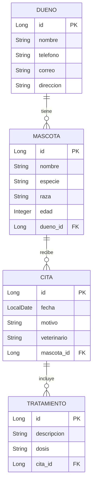

# Sistema de Gestión Veterinaria (`labsoftp`)

## INTEGRANTES
- Nicolás Chaparro **(2380530)**
- Ricardo Zuluaga **(2160051)**

Laboratorio #2 - Desarrollo de Software III (Tecnología en Sistemas, Universidad del Valle, Sede Tuluá).

Aplicación web en **Java 21** y **Spring Boot 3.4.2** (Spring Web, Spring Data JPA, Thymeleaf) con base de datos **MySQL**, para gestionar dueños, mascotas, citas médicas y tratamientos. Incluye una API REST con CRUD completo y una interfaz web con listados, formularios y menú de navegación.

| Módulo | Vista web | API REST |
|---|---|---|
| Inicio | `/` | - |
| Dueños | `/duenos` | `/api/duenos` |
| Mascotas | `/mascotas` | `/api/mascotas` |
| Citas | `/citas` | `/api/citas` |
| Tratamientos | `/tratamientos` | `/api/tratamientos` |

La API acepta `GET` (listar y consultar por id), `POST`, `PUT` y `DELETE`.

## Ejecución

### Con Docker (recomendado)

Requisito: Docker Desktop en ejecución. Desde la carpeta raíz del proyecto (donde están `pom.xml`, `Dockerfile` y `docker-compose.yml`):

```bash
docker compose up --build -d      # construye y levanta la base de datos y la aplicación
docker compose logs -f app        # esperar a ver "Started LabsoftpApplication"
```

Luego abrir **http://localhost:8080/**.

> Si el puerto 8080 está ocupado, cambiar `"8080:8080"` por `"8081:8080"` en `docker-compose.yml` y usar `http://localhost:8081/`.

Para detener los servicios:

```bash
docker compose down        # conserva los datos
docker compose down -v     # borra también la base de datos
```

Se levantan dos servicios: `db` (MySQL 8.0, base `labsoft`) y `app` (Spring Boot, compilada con un Dockerfile multi-etapa). Los datos de prueba de `data.sql` (5 dueños, 6 mascotas, 6 citas y 7 tratamientos) se cargan automáticamente en cada arranque.

### Sin Docker (opcional)

Requiere un MySQL local en `localhost:3306` con la base `labsoft` creada (usuario `root` sin contraseña, según `application.properties`):

```bash
mvnw.cmd spring-boot:run     # Windows
./mvnw spring-boot:run       # Linux / macOS
```

### Pruebas de la API

Importar `veterinaria_postman_collection.json` en Postman y ajustar la variable `baseUrl` al puerto usado. Ejecutar las peticiones una por una: eliminar el dueño con id 1 borra en cascada sus mascotas, citas y tratamientos.

## Diagrama de relaciones



Un dueño tiene varias mascotas, cada mascota recibe varias citas y cada cita incluye varios tratamientos. En las tres relaciones (1 a N) la llave foránea está del lado "muchos" y es obligatoria (`nullable = false`).

| Relación | Lado "uno" | Lado "muchos" |
|---|---|---|
| Dueño - Mascota | `Dueno`: `@OneToMany(mappedBy = "dueno")` | `Mascota`: `@ManyToOne` + `@JoinColumn(name = "dueno_id")` |
| Mascota - Cita | `Mascota`: `@OneToMany(mappedBy = "mascota")` | `Cita`: `@ManyToOne` + `@JoinColumn(name = "mascota_id")` |
| Cita - Tratamiento | `Cita`: `@OneToMany(mappedBy = "cita")` | `Tratamiento`: `@ManyToOne` + `@JoinColumn(name = "cita_id")` |

Los lados `@OneToMany` usan `cascade = ALL` y `orphanRemoval = true`: eliminar un registro padre elimina también sus hijos. Las tablas `clientes` y `usuarios` son módulos independientes y no se relacionan con estas entidades.
